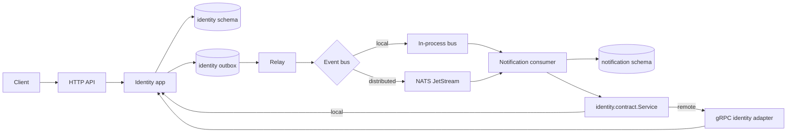

# Architecture design

This template is a modular monolith with hexagonal module boundaries. A module owns its domain, application, adapters, migrations, PostgreSQL schema, and database role. Other modules may import only its `contract` package. The composition root selects local or gRPC adapters without changing business logic.

## Processes and messages

The default `cmd/api` process runs HTTP, the outbox relay, and consumers. `cmd/worker` supports worker-only deployment. In distributed mode identity and notification run separately; their event transport is JetStream and synchronous calls use gRPC.

## Contracts

- `identity.contract.Service.GetUser(ctx, userID)` returns an internal user DTO with ID, email, and creation time.
- `identity.contract.UserRegistered` version 1 contains only `user_id`.
- `notification.app.Sender.SendWelcome(ctx, recipient)` is an application port; the example adapter logs the delivery.
- Application ports include repository, unit of work, password hasher, and token issuer. Domain packages import only the standard library.
- An event envelope carries UUIDv7 ID, type, version, occurrence time, aggregate ID, request ID, trace ID, W3C traceparent, and JSON payload.

## Data ownership

`identity.users` stores normalized email, password hash, and timestamps. `identity.refresh_tokens` stores only token hashes and rotation state. `notification.welcome_deliveries` records one database effect per source event. Identity owns `outbox` and `idempotency_keys`; Notification owns `outbox` and `processed_events`. Both have their own `schema_migrations` table. No cross-module foreign keys or joins are permitted.

The relay claims rows with `FOR UPDATE SKIP LOCKED`, publishes, and marks them delivered. This prevents concurrent claims, but a crash between publish and commit can publish again. Consumers insert `(event_id, consumer)` into `processed_events` in the same transaction as their database effect. The Sender's external side effect remains at least once unless the destination supplies its own idempotency key.

## API

| Method | Path | Success |
| --- | --- | --- |
| POST | `/v1/users/register` | 201 user |
| POST | `/v1/auth/login` | 200 access and refresh tokens |
| POST | `/v1/auth/refresh` | 200 rotated tokens |
| GET | `/v1/users/me` | 200 current user |
| GET | `/v1/users` | 200 cursor-paginated IDs and creation times |
| GET | `/healthz` | 200 liveness |
| GET | `/readyz` | 200 or 503 dependency readiness |
| GET | `/metrics` on port 9100 | 200 Prometheus metrics |

HTTP errors use `{"error":{"code","message","request_id"}}`. Authenticated user lists omit email. Cursor ordering is `(created_at, id)` with a limit from 1 to 100.

## Decisions

- Go 1.26.9 is the patched 1.26 toolchain required by the vulnerability gate; it supersedes the 1.26.3 toolchain originally installed at Phase 0.
- Root `compose.yaml` supports direct `docker compose up` acceptance.
- Phase 4 logs welcome delivery by user ID; Phase 5 adds the synchronous identity contract lookup for email while keeping the event payload unchanged.
- Phase 0 used design approval instead of a Makefile gate because the repository had no Makefile before Phase 1.
